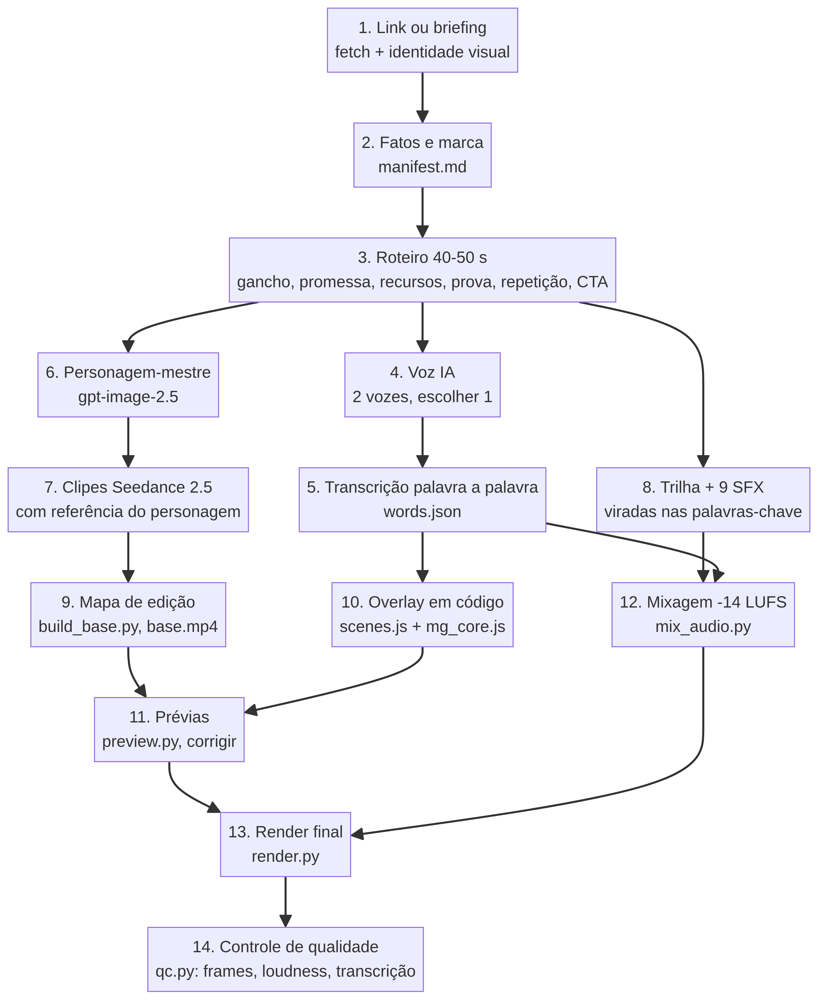
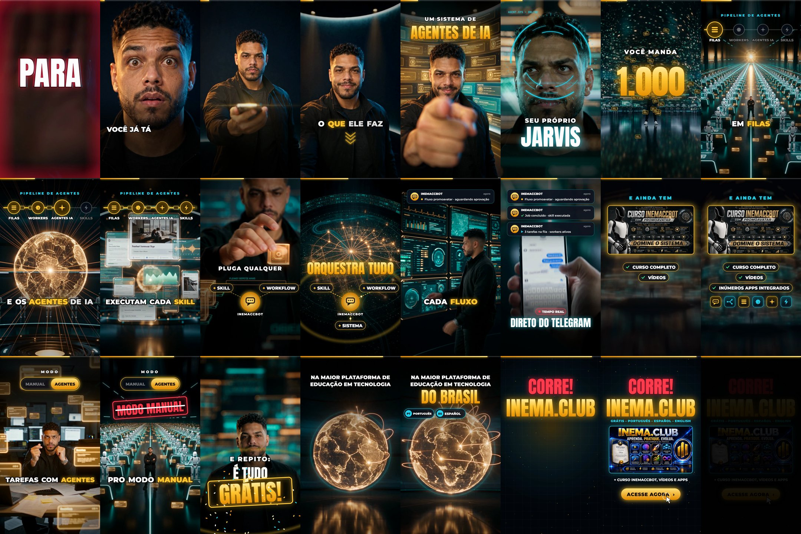

# Guia: como criar vídeos virais 9:16 como os do INEMACCBOT

Este guia registra **como os dois vídeos do INEMACCBOT foram feitos**, com os mesmos recursos, prompts, roteiros e código. Você pode usá-lo de dois jeitos:

1. **Pedindo ao Manus:** cole um dos pedidos prontos da seção 6. A skill `video-viral-9x16` faz o resto.
2. **Rodando você mesmo:** use os scripts do kit (seção 7).

| Vídeo | Gancho | Duração | Voz |
|---|---|---|---|
| 1 - explicativo | "Você ainda faz uma tarefa de cada vez?" | 53,5 s | Fenrir |
| 2 - gatilho de atenção | "Para tudo! Você já tá usando o INEMACCBOT? Ele é de graça." | 48 s | Puck |

## 1. A ideia central do método

> **A IA gera o que ela faz bem (rosto, cenas, voz, música, efeitos). O código faz o que precisa ser perfeito (texto, legendas, sincronia, ritmo, marca).**

Por isso os textos nunca saem tortos ou com letras inventadas, cada palavra-chave "explode" na tela no momento exato em que é falada e as viradas da música caem nas palavras mais importantes.



## 2. Recursos usados

| Etapa | Recurso | Função |
|---|---|---|
| Pesquisa | `fetch` + navegador | Ler a página do produto, pegar cores, logo e imagens oficiais |
| Roteiro | Fórmulas de gancho (ver `references/roteiro-e-ganchos.md`) | 40 a 50 s, cerca de 110 palavras |
| Voz | `generate_speech` + skill `tts-prompter` | Locução pt-BR; 2 vozes testadas, a melhor escolhida |
| Sincronia | `manus-speech-to-text -g word` | Tempo de início e fim de cada palavra falada |
| Personagem | `generate_image` (gpt-image-2.5) | Um "ator" fixo, usado como referência em todas as cenas |
| Cenas | `generate_video` (Seedance 2.5, vertical, 720p) | Clipes longos com vários planos minutados |
| Trilha | `generate_music` + skill `music-prompter` | Eletrônica cinematográfica de 126 BPM com 2 grandes viradas |
| Efeitos | `generate_sound_effect` | Kit de 9 SFX (impacto, whoosh, pop, riser, chime, glitch, scratch, sub-drop, notificação) |
| Edição | FFmpeg (`build_base.py`) | Cortes, câmera lenta, correção de cor, 1080x1920 |
| Motion graphics | Node + canvas (`mg_core.js` + `scenes.js`) | Títulos, legendas karaokê, selos, HUD, notificações, cartão final |
| Áudio | FFmpeg (`mix_audio.py`) | Voz tratada, música que abaixa quando ele fala, SFX, -14 LUFS |
| Final | `render.py` + `qc.py` | MP4 H.264/AAC + checagem de frames, volume e inteligibilidade |

## 3. Passo a passo (o que foi feito)

1. **Briefing.** Li a página do INEMACCBOT e anotei fatos e números: gestão de filas, workers, agentes, skills, workflows, monitoramento pelo Telegram, curso, vídeos, apps integrados, grátis, PT/ES/EN e o domínio inema.club. Baixei a capa do curso e a imagem do INEMA.CLUB.
2. **Roteiro.** Montei o roteiro na estrutura *gancho → promessa → o que é → como funciona → prova → contraste → repetição → autoridade → CTA*, com a palavra-chave sempre no fim da frase.
3. **Voz.** Gerei duas vozes com o mesmo texto e escolhi a mais enérgica. Transcrevi palavra a palavra para obter os tempos.
4. **Personagem.** Gerei uma foto-mestre de um homem brasileiro de jaqueta preta em fundo azul-marinho. Ela entrou como referência em todos os clipes, então o rosto é sempre o mesmo.
5. **Cenas.** Gerei 5 clipes Seedance (22, 16, 7, 10 e 10 s), cada um com vários planos descritos com minutagem: dor → tecnologia → escala → resultado.
6. **Trilha e efeitos.** Gerei a trilha com viradas planejadas e o kit de 9 SFX. No vídeo 2, a geração de música falhou, então **remixei a trilha do vídeo 1** (+1 semitom, trechos reorganizados) para as viradas caírem em "de **graça**" e "é tudo **grátis**".
7. **Mapa de edição.** Analisei os cortes de cada clipe e escolhi qual trecho cobre cada frase, com câmera lenta suave onde precisava esticar.
8. **Motion graphics.** Programei uma seção por frase: palavras gigantes com glitch, carimbo "DE GRAÇA", selo "R$0", HUD "Jarvis", contador 10→100→1.000, pipeline animado, notificações do Telegram, card do curso, "modo manual" riscado, confete, globo e cartão final com botão.
9. **Prévias e correções.** Gerei folhas de prévia sobre os frames reais e corrigi texto em cima de rosto, sobreposições e símbolos que a fonte não tinha.
10. **Mixagem, render e QC.** Mixei a -14 LUFS, renderizei em 1080x1920 a 30 fps e conferi frames, volume e uma transcrição do áudio final para garantir que a fala está clara sobre a música.



## 4. Os roteiros

**Vídeo 1 (explicativo):**

> Você ainda faz uma tarefa de cada vez? Enquanto isso, tem gente rodando 100 tarefas ao mesmo tempo. Conheça o Inema CCBot, um sistema de agentes que funciona como o seu próprio Jarvis. Você manda as tarefas, ele organiza tudo em filas, distribui pros workers, aciona os agentes de IA e executa cada skill. Bot, fluxo, fila, worker, agente e skill, tudo trabalhando junto, como um único cérebro. Quer integrar qualquer skill, qualquer workflow, qualquer sistema? Ele orquestra tudo. E você monitora cada fluxo e cada job em tempo real, direto do Telegram. São cursos, vídeos e inúmeros apps integrados. Um verdadeiro salto no conhecimento e na gestão de tarefas e agentes. E o melhor: é tudo gratuito, na maior plataforma de educação em tecnologia do Brasil, em português, espanhol e inglês. Acesse agora: inema.club.

**Vídeo 2 (gatilho de atenção):**

> Para tudo! Você já tá usando o Inema CCBot? Ele é de graça. E olha o que ele faz. É um sistema de agentes que funciona como seu próprio Jarvis. Você manda dez, cem, mil tarefas. Ele organiza tudo em filas, distribui pros workers e os agentes de IA executam cada skill. Pluga qualquer skill, workflow ou sistema e ele orquestra tudo. Você acompanha cada fluxo em tempo real, direto do Telegram. Ainda tem curso completo, vídeos e inúmeros apps integrados. Quem escala tarefas com agentes não volta mais pro modo manual. E repito, é tudo grátis! Na maior plataforma de educação em tecnologia do Brasil, em português, espanhol e inglês. Corre, inema.club.

### Por que o gancho do vídeo 2 prende

| Camada | O que acontece no frame 0 |
|---|---|
| Som | Record scratch + impacto grave: o cérebro registra "algo parou" |
| Imagem | Close do rosto chocado, depois a mão em "PARE" na direção da lente |
| Texto | "PARA TUDO!" gigante, tremendo, com glitch e borda vermelha pulsando |
| Pergunta | "Você já tá usando…?" cria a dúvida "estou ficando para trás?" |
| Recompensa | Em 4 s: "Ele é de **graça**", com carimbo dourado e a 1ª virada da trilha |

## 5. Fórmulas para os próximos vídeos

**Ganchos que funcionam (troque o produto):**

| Tipo | Modelo |
|---|---|
| Ordem direta | "Para tudo! Você já tá usando o [produto]?" |
| Pergunta de dor | "Você ainda faz [tarefa] uma de cada vez?" |
| Comparação injusta | "Enquanto você faz 1, tem gente fazendo 100." |
| Preço chocante | "Isso custa R$0. Sério." |
| Segredo | "Ninguém te contou que dá pra [resultado] de graça." |
| Erro comum | "Se você ainda [faz X], está perdendo [Y]." |
| Número | "1.000 tarefas. Zero esforço. Olha isso." |
| Identidade | "Se você trabalha com [área], salva esse vídeo." |
| Antes e depois | "Eu levava 8 horas. Agora leva 8 minutos." |
| Urgência | "Corre, que isso ainda é grátis." |

**Checklist de vídeo viral:**
- [ ] Gancho com som, imagem e texto juntos no primeiro frame (sem logo, sem "olá")
- [ ] Benefício principal nos primeiros 5 s e repetido no último terço
- [ ] Um corte a cada 1,5 a 4 s; nada parado por mais de 4 s
- [ ] Uma palavra-chave grande por frase, sincronizada com a fala
- [ ] Legendas karaokê nas partes sem título grande
- [ ] Números concretos ("dez, cem, mil")
- [ ] Viradas da música nas palavras-chave
- [ ] Texto fora das zonas cobertas pelo app (topo, rodapé, lateral direita)
- [ ] CTA único, falado e escrito igual
- [ ] Áudio a -14 LUFS e fala inteligível sobre a música

## 6. Como pedir um novo vídeo ao Manus

Com a skill `video-viral-9x16` instalada, basta um pedido como estes:

**Novo produto:**
```text
Use a skill video-viral-9x16. Crie um vídeo viral 9:16 de 45 s sobre <link da página>.
Público: <quem>. Benefício principal: <ex.: é grátis>. CTA: <domínio>.
Gancho do tipo "pergunta de dor". Voz masculina animada em pt-BR. Mesmo estilo dourado/ciano do INEMACCBOT.
```

**Variação de um vídeo existente:**
```text
Use a skill video-viral-9x16 e o exemplo inemaccbot-v2. Faça uma variação com o gancho
"Ninguém te contou que dá pra rodar 1.000 tarefas de graça". Reaproveite os clipes e a trilha,
gere uma nova narração e ajuste as cenas.
```

**Outro idioma:**
```text
Use a skill video-viral-9x16 e refaça o vídeo 2 do INEMACCBOT em espanhol (es-US) e em inglês (en-US).
Reaproveite os clipes; nova voz, nova transcrição e textos da tela traduzidos.
```

**Outro personagem ou marca:**
```text
Use a skill video-viral-9x16. Crie um personagem-mestre <descrição> e use as cores <#hex, #hex>.
Produto: <link>.
```

## 7. Como rodar por conta própria

**Requisitos:** Node 18+, Python 3.10+, FFmpeg, `pip install numpy pillow librosa` (librosa só para análise de trilha). As mídias (voz, personagem, clipes, trilha, SFX) são geradas no Manus; o resto roda em qualquer máquina.

```bash
# 1. criar o projeto (copia motor, fontes, ferramentas e modelos)
bash video-viral-9x16/scripts/new_project.sh meu-video
cd meu-video
# 2. colocar narracao.wav em audio/ e transcrever (no Manus)
manus-speech-to-text audio/narracao.wav -g word
python3 tools/words_from_stt.py audio/narracao_transcription_*.json audio/words.json
# 3. colocar clipes em broll/, SFX em audio/sfx/, música em audio/; analisar
python3 tools/analyze_clip.py broll/clipA.mp4
python3 tools/music_tool.py analyze audio/music.mp3
# 4. editar project.json (timeline, segments, captions) e scenes.js (COPY e seções)
python3 tools/preview.py project.json teste 0.5 3 5 10 20 30 38   # abrir out/prev/teste.jpg
# 5. produzir
python3 tools/build_base.py project.json
python3 tools/mix_audio.py project.json
python3 tools/render.py project.json
python3 tools/qc.py project.json
```

Para estudar o vídeo 2 completo, abra a pasta `exemplo-inemaccbot-v2`. Ela tem o mesmo `project.json`, `scenes.js` e mídias, e os comandos acima a reproduzem **frame a frame** (verificado).

**O que editar para adaptar:**

| Quero mudar | Onde |
|---|---|
| Cores da marca | `project.json → brand` |
| Textos da tela | `scenes.js → COPY` (modelo) ou cada seção |
| Em qual palavra cada texto explode | `scenes.js → SYNC` ou `at('palavra', tempo)` |
| Onde ficam os cortes | `project.json → timeline` |
| Qual cena cobre cada frase | `project.json → base.segments` |
| Onde aparecem legendas | `project.json → captions.windows` |
| Volume da música e dos efeitos | `project.json → audio.music_gain` e `sfx_gain` |

## 8. Conteúdo do kit

| Pasta ou arquivo | O que é |
|---|---|
| `skill/video-viral-9x16/` | A skill completa: `SKILL.md`, scripts, motor, fontes, modelos e referências |
| `skill/.../references/prompts.md` | Prompts de personagem, das 5 cenas, da voz, da trilha e dos 9 SFX |
| `skill/.../references/roteiro-e-ganchos.md` | Estrutura, ganchos, roteiros e mapa de cenas segundo a segundo |
| `skill/.../references/engine-api.md` | Todos os componentes do motor de motion graphics |
| `skill/.../references/edit-and-timing.md` | Edição, zonas seguras, áudio e armadilhas já resolvidas |
| `exemplo-inemaccbot-v2/` | Projeto do vídeo 2 pronto para estudar ou re-renderizar |
| `originais-inemaccbot/` | Scripts originais exatamente como foram usados nos vídeos 1 e 2 |
